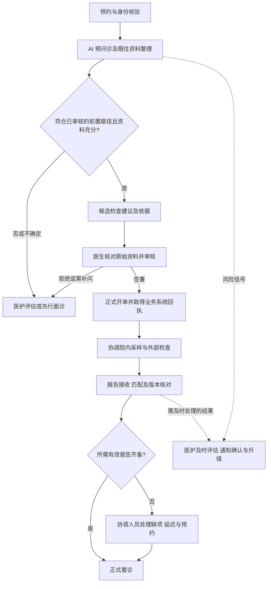
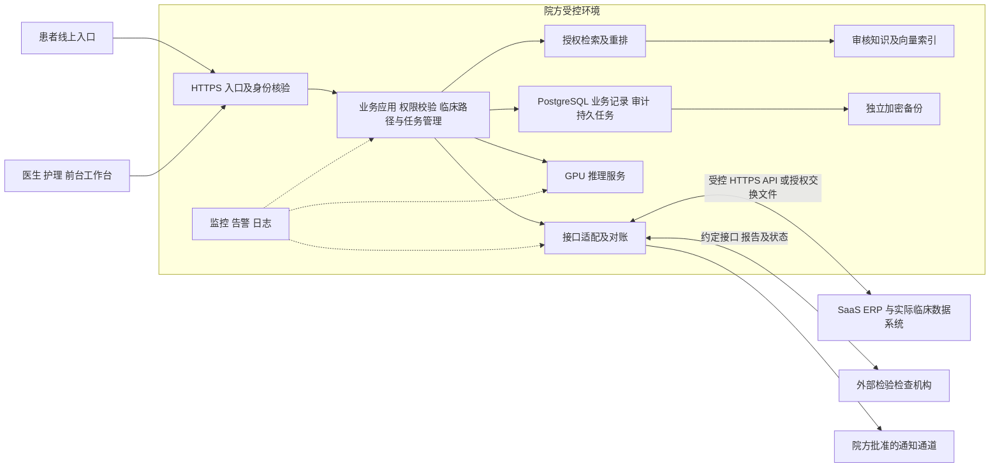

# 综合内科社区 Clinic AI 私有化项目实施方案

版本：V1.0 面试讨论稿｜日期：2026-10-24｜文档维护：项目实施负责人

基线：项目内《医院假设条件》（hospital-assumptions.md）。本文补充的硬件配置、负载、验收阈值与周期均为规划建议，不代表已有采购、实测结果或院方承诺。现场调研后形成签字确认的范围和验收基线；接口、临床路径或模型版本变更时同步更新本文与测试记录。

**项目交付目标：**在现有 SaaS 业务之上，交付“AI 预问诊—候选检查建议—医生审核开单—院内外检查协同—报告回传—正式看诊”的完整流程。对经过临床审核、适合检查前置的患者，争取在正式看诊前取得所需报告，同时验证医患双方是否真正净节省时间。

**关键判断：**首期聚焦少量检查路径；医疗决策由医生审核授权；业务状态来自真实系统；采用单 GPU 推理与独立应用主机；按接口能力分级交付；按临床质量、业务价值与技术质量共同验收。

## 0. 已知条件、工作假设和待确认事项

| 类别 | 内容 | 对方案的约束 |
|---|---|---|
| 题目已知 | 新加坡私立医院，10 名医生；已有 SaaS ERP，正常业务运行；硬件以 NVIDIA AI 一体机为基础 | 保留现有系统，增加 AI 能力，不以重建 ERP 解决集成问题 |
| 题目边界 | 不训练基础模型；可参考国内非外科临床业务；暂不研究新加坡特殊法规和认证，但需基本数据安全设计 | 首期采用现有模型、知识检索和业务规则；真实投产前仍需另行核实当地要求 |
| 已确定的模拟定位 | 综合内科私人社区 clinic；诊疗与检查资源紧张；院内基础检查、采样与外部合作检验并存 | 围绕患者流程、资源协调及体验选场景 |
| 已确定的目标流程 | AI 参与提出检查建议，经医生审核开单后，在正式看诊前完成部分检查 | “完成”以相关报告已回传、匹配且可查阅为目标，不能只统计已采样 |
| 工作假设 | 以预约为主；院方能够指定临床负责人、预审医生、护理或前台协调人及 IT 联系人 | 前置审核和异常处理须进入排班及工作量统计 |
| 工作假设 | 首期选择 2—3 条高频、适合前置且报告周期可协调的路径，先由 2—3 名医生试用 | 具体病种、项目和人群由临床负责人确认，不预设所有初诊均适用 |
| 待确认 | ERP 的业务模块、临床资料来源、接口读写和沙箱；外部检查机构的数据能力 | “已用 ERP”不能直接推定有可用病历、开单和报告接口 |
| 待确认 | 首期是否覆盖初诊、语言与入口、真实接诊量、并发、检查目录和报告周期 | 不把示例接诊量当成事实，不据医生人数直接推算 GPU 数量 |
| 待确认 | 一体机是否已采购、预算、机房、网络、维保及现有虚拟化资源 | 采购配置由 POC、兼容性和本地服务共同决定 |

上述未知项均有处理路径：第 1—2 周核实并冻结范围；不满足依赖时，选择第 3.1 节的辅助交付版本，或调整工期。不得把人工录单版本按自动闭环验收。

## 1. 需求分析：首批应用与选择理由

### 1.1 角色、问题与首批交付

现状痛点是本次模拟假设，实际实施时以访谈、跟诊观察和现有时间记录核实。典型场景是：患者预约后，医生在正式看诊前快速审核经过整理的资料及候选检查；患者完成准备和检查；医生看诊时能够查看相关报告。与必须先面诊的患者分别处理。

| 场景 | 输入与输出 | 首批选择理由 | 验证方式 |
|---|---|---|---|
| AI 预问诊与病史整理 | 输入患者自述及授权读取的资料；输出必要追问、病史摘要、信息来源和缺项 | 减少重复询问，给检查建议提供可核对的信息 | 抽查摘要事实、遗漏和患者完成情况；统计医生核对时间 |
| AI 辅助检查建议 | 依据审核后的临床路径、历史结果与当前信息，输出候选项目、理由、依据及人工评估事项 | 是检查前置的核心；历史结果提示可帮助医生评估是否需要复查 | 与医生独立标注比较，记录不适当前置、漏项、不当追加和修改原因 |
| 检查准备与导诊 | 读取正式医嘱、项目准备要求和真实预约资源；输出地点、时间、准备说明与下一步 | 减少准备不足、走错流程、重复咨询和额外往返 | 统计准备不足、失约、咨询量、患者等待及往返 |
| 报告齐备与异常待办 | 关联医嘱、采样和报告，识别未完成、延迟、缺项、修订及需及时处理的结果 | 保证检查前置能够衔接正式看诊 | 核对正式看诊前报告可用率及异常闭环记录 |

前两项以 AI 理解和辅助判断为主；后两项主要由业务状态、任务与规则驱动，AI 提供摘要和解释。临床决策支持应进入实际工作流，让合适的人在能够采取行动的环节获得信息，参考 [AHRQ 的 CDS 工作流原则](https://www.ahrq.gov/cpi/about/otherwebsites/cds-connect/index.html)。

### 1.2 主流程和人工接管

报告不齐时由医护决定继续看诊、补充检查或调整预约，不自动无限等待。需及时处理的结果单独通知，不受“齐备后看诊”限制。

### 1.3 首期边界与取舍

- 院方提供或批准检查路径、适用条件、必要信息和升级规则；AI 在该范围内提出候选建议。采用可解释的临床理由和来源，不展示或依赖模型内部思维链。
- 医生能够查看原始资料、补问、修改和拒绝；签署绑定患者、就诊、具体项目及建议版本，建议绑定所引用报告版本。项目发生变化须重新确认，不能复用旧授权。
- 临床路径规定建议和前置授权的有效期及有效条件。过期，或症状、病史、用药、报告等关键资料发生足以影响适宜性的变化时，挂起前置安排并由医护复核；不自动取消既有正式医嘱，复核决定与最终授权留痕。
- 对资料不足、超范围或需要先面诊的患者转医护；不以模型自报的置信度判定可安全前置。
- 首期不交付自动独立开检查、自动取消医嘱、自动诊断或处方、影像诊断、基础模型训练及完整新建 HIS/ERP。
- 首期输入以文字和已有结构化报告为主。扫描报告可辅助录入，但患者信息、项目、结果、单位和日期经核对后才能用于建议；语音及更广泛多模态功能另行评估。

医生审核必须是能发现问题的真实操作。WHO 指出生成式模型可能产生不准确或不完整内容，并可能导致自动化偏见；因此本项目把资料核对、边界测试及持续评审列入交付，参见 [WHO 医疗生成式 AI 指导](https://www.who.int/news/item/18-01-2024-who-releases-ai-ethics-and-governance-guidance-for-large-multi-modal-models)。

## 2. 总体架构：硬件、模型、知识库与基础设施

### 2.1 架构及信任边界

采用一个模块化业务应用，配套接口适配、持久化任务及推理服务。应用与数据库优先部署在独立 CPU 主机或院内受控虚拟机，GPU 主机提供模型推理，降低 GPU 故障对流程管理的影响。首期采用容器部署和版本化配置，不默认引入 Kubernetes、复杂微服务或多智能体自主执行。

公网入口与内部应用分区；数据库、管理端及推理接口不直接暴露互联网。患者入口只能通过应用读取本人授权信息。通知通道只发送必要的待办提示，敏感报告在身份核验后的入口查看。

“私有化”指 AI 推理、嵌入、重排及相应患者数据留在院方受控环境；现有 SaaS、外部检查和通知的数据流另行登记，不能宣称患者数据全程不出院。若不具备安全的院内公网入口，则先限院内或使用经批准的安全接入，不绕过网络边界强行开放。

### 2.2 NVIDIA 一体机选型

“一体机”采购对象是经验证的 OEM 整机、操作系统与驱动组合、安装支持和本地维保，不仅是一张显卡。优先选择有新加坡本地备件及服务承诺的整机供应商。

| 项目 | 一期规划建议 | 判断依据与限制 |
|---|---|---|
| GPU 基线 | 1 × NVIDIA L40S，48 GB 显存；整机预留扩展条件 | 给 14B 级模型权重和 KV 缓存留空间；具体并发必须实测 |
| 预算受限候选 | L4 24 GB，加经过同题质量对照的量化模型 | 不把 24 GB 当成可直接容纳完整 BF16 14B 模型；POC 不达标则缩小负载或调整配置 |
| GPU 主机 CPU/RAM | 16—24 核 CPU、128 GB ECC 内存 | 一期规划值，用于加载、预处理及服务运行，不是厂商最低要求 |
| GPU 主机存储 | 2 × 1.92 TB 企业级 NVMe 镜像，保留模型及镜像版本 | 镜像仅防单盘故障，不替代备份；容量按版本数、增长及现场数据盘点校核 |
| 独立应用主机 | 8—16 核 CPU、32—64 GB RAM、约 1 TB 可用冗余存储，可用现有合格虚拟化资源 | 承载应用、PostgreSQL、检索、任务和监控；仍是需要备份和恢复方案的单点 |
| 网络和机房 | 内网至少 1 GbE，具备条件时采用 10 GbE；UPS、冗余电源、管理网络与监控 | 核实整机功耗、风道、温湿度、噪声及停电策略；显卡功耗不等于整机功耗 |

NVIDIA 官方规格中，L4 为 24 GB、72 W 卡功耗；L40S 为 48 GB ECC、350 W 卡功耗，且不支持 NVLink。参见 [L4](https://www.nvidia.com/en-us/data-center/l4/) 和 [L40S](https://www.nvidia.com/en-us/data-center/l40s/)。两张 24 GB 卡的显存不能自动作为一张 48 GB 卡使用；多卡切分有框架和通信要求。增加第二张卡可用于吞吐或独立副本，但同一整机内双卡不构成主机级高可用。

采购前以本项目的模型、提示词、脱敏样本和第 7.2 节负载执行 POC，记录延迟、显存峰值、队列、错误及质量。未达标时依次检查输入长度、批处理、检索开销和量化影响，再决定升级硬件；不凭峰值算力或医生人数承诺吞吐。

### 2.3 模型与推理部署

| 组件 | 基线选择与部署 | 验证要求 |
|---|---|---|
| 主模型 | Qwen3-14B，先建立 BF16 质量基线；常规结构化任务使用非 thinking 模式，限制输入输出 | 中英能力、事实保真、检查建议和拒答均用 clinic 样本验证 |
| 量化候选 | 官方 Qwen3-14B-AWQ，按需与 BF16 对照 | 量化前后做同题比较；性能改善不能掩盖临床质量下降 |
| 嵌入 | Qwen3-Embedding-0.6B，在本地提供服务；优先 CPU 小规模建库和查询 | 实测检索质量与耗时，防止挤占交互推理资源 |
| 重排 | Qwen3-Reranker-0.6B，限定候选条数，POC 决定是否启用 | 只有在召回质量有收益且时延可接受时保留 |
| 推理引擎 | vLLM，采用结构化输出约束；驱动、容器、模型和模板固定版本及哈希 | JSON 合法仍可能事实错误；后端另做字段、权限、项目和授权校验 |
| 厂商支持选项 | 对需要企业支持的客户评估 NVIDIA NIM 对应分支 | 核验具体模型、GPU、镜像及许可组合，不假设可直接替换所有模型 |

Qwen3-14B 官方模型卡标注约 14.8B 参数及 Apache-2.0 许可；BF16 仅权重粗算约 29.6 GB 十进制字节，尚未计入 KV 缓存、临时张量和运行时开销。嵌入、重排及量化候选也需随实际交付保留各自许可证和模型卡。参考 [主模型](https://huggingface.co/Qwen/Qwen3-14B)、[AWQ](https://huggingface.co/Qwen/Qwen3-14B-AWQ)、[Embedding](https://huggingface.co/Qwen/Qwen3-Embedding-0.6B)、[Reranker](https://huggingface.co/Qwen/Qwen3-Reranker-0.6B)。开源许可不代表模型已适合本项目临床用途。

vLLM 支持结构化输出，参考 [官方文档](https://docs.vllm.ai/en/latest/features/structured_outputs/)。应用约束输出为摘要、缺项、候选检查编码、理由、来源和转人工原因；模型无直接开单凭据。首次部署先限定 4 个活跃生成请求，初始上下文上限 16k tokens，具体数值由显存和压测调整。常规病例按第 7.2 节较短输入测量；超长资料须分段整理、保留出处并提示未纳入内容，禁止静默丢弃关键资料。

NIM 当前不同分支的许可和企业支持条件不同；如采用 Certified Production Branch，需核实 AI Enterprise 订阅及合同，参见 [NIM Offerings](https://docs.nvidia.com/nim/large-language-models/latest/about-nim-llm/nim-offerings.html)。本方案基线采用 vLLM，避免同时维护两套生产推理栈。

### 2.4 知识库与建议生成

1. **来源与责任：**收集院方批准且有权使用的检查路径、项目目录、准备要求和服务流程；指定作者、审核人、适用范围、生效及复审日期。外部指南经临床审核后才能进入生产知识库。
2. **结构化规则：**将路径适用条件、必要字段、允许项目编码、人工升级条件整理为可测试规则；具体医学阈值由临床负责人签署，不由模型自行生成。
3. **检索：**文档按标题与语义分段，初始约 300—800 tokens 并保留来源；关键词与向量联合召回，必要时重排。采用 PostgreSQL + pgvector，首期减少独立数据库数量，参考 [pgvector 官方项目](https://github.com/pgvector/pgvector)。
4. **权限：**检索前在服务端执行文档和患者权限过滤，不能让模型决定可见范围。通用临床知识与患者资料分离；不把全院病历直接放进共享知识索引。
5. **生成与校验：**模型结合授权患者上下文、结构化路径和检索资料提出候选建议；后端校验项目是否存在、路径是否适用、信息是否齐全及出处是否有效。校验失败或来源冲突转人工，不能靠补造引用继续输出。
6. **发布：**知识版本与索引版本配套。新版本先离线回归，再原子切换；索引失败继续使用上一批准版本，不混用未完成索引。临床路径更新需要重新审核。

### 2.5 基础安全设计

- 身份核验后再读取资料；医生按诊疗关系和职责访问，护理、前台仅获得完成工作所需信息。运维默认不查看病历正文，必要访问受审批及审计约束。
- 外部通信采用 HTTPS；跨系统身份、令牌和院内服务权限按最小权限配置。密钥放入受控密钥存储或受限配置，不写入代码、模型提示词及日志。
- 数据盘及独立备份加密，传输、下载和恢复均有权限控制；脱敏测试数据与生产隔离。通用日志不记录完整病历、令牌和证件信息；临床建议及审计正文存于专门受控区域。
- 第 2 周由院方批准数据目录和留存表，逐项明确缓存、上传原件、建议、审计及备份的期限、删除和恢复处理；不能把 AI 缓存默认为永久病历档案。
- 上传文件和报告视为不可信数据：限制类型与大小、恶意文件扫描、解析隔离；文档中的指令不获得工具权限。模型仅能访问白名单工具，执行动作仍由应用校验授权。
- 模型文件和镜像通过受控渠道获取、校验哈希、扫描依赖并固定版本；关闭不必要遥测和外发，远程维护采用批准的安全通道及限时账号。

RAG 不能消除提示注入风险；本项目将权限和执行限制放在应用及接口层，并测试恶意报告和跨患者读取，参考 [OWASP Prompt Injection](https://genai.owasp.org/llmrisk/llm01-prompt-injection/)。

## 3. 系统集成：接口、格式、权限及异常

### 3.1 先确认能力，再决定交付级别

| 实际条件 | 交付方式 | 验收边界 |
|---|---|---|
| 有授权读写 API、可查询医嘱、测试环境及报告接口 | 经医生签署后写入正式系统，自动接收回执和报告，执行对账 | 可按自动闭环目标验收 |
| 有读取或导出能力，缺少安全写回；外检仅有门户或文件 | AI 提供摘要、检查建议及待办，医生在原系统开单；工作人员核对录入或导入报告 | 明确为辅助版本，统计人工耗时，不宣称自动闭环已交付 |
| 缺少可靠数据和身份关联，或无授权接口 | 先完成流程与有限资料试点，推动供应商提供接口；不足的临床范围不上线 | 临床与自动化范围缩减或工期调整；不通过未授权抓取绕过限制 |

若 ERP 仅承载财务、库存和收费，应对接实际病历及检查来源。首期可以建立必要的预问诊和任务记录，但不扩展为完整新建电子病历系统。

### 3.2 接口清单与数据责任

| 对象 | 方向 | 关键字段与责任 |
|---|---|---|
| 患者、预约、就诊 | 读取；预约调整按授权另行开放 | 来源系统、患者唯一编号、就诊与预约编号、状态、时间、诊疗关系 |
| 历史病史、用药和报告 | 按范围读取 | 来源、记录时间、正文或结构化字段、报告状态及版本；保留患者自述标记 |
| 检查目录与资源 | 读取及定期校核 | 机构与项目编码、样本类型、准备条件、可预约时间、送检截单和预计周转 |
| 正式检查医嘱 | 医生签署后写入，回读确认 | 患者、就诊、项目、签署人和时间、建议版本、幂等业务键及系统医嘱号 |
| 采样、执行与报告 | 接收事件或增量读取 | 医嘱号、采样条码、检验流水号、报告号、状态、结果时间与修订版本 |
| 通知与待办 | 发送并记录确认 | 收件角色、用途、状态、处理人、确认时间及升级记录；必要人工备用渠道 |

以供应商实际协议为准，优先使用其支持的 REST/JSON；已有 HL7 v2 或 FHIR 时通过适配层接入。FHIR 可参考 Patient、Appointment、Encounter、ServiceRequest、DiagnosticReport、Observation 等资源，但不能假定厂商支持全部资源和操作。参考 [FHIR R4 HTTP](https://hl7.org/fhir/R4/http.html)、[DiagnosticReport](https://hl7.org/fhir/R4/diagnosticreport.html)、[Observation](https://hl7.org/fhir/R4/observation.html)。版本在联调时固定。

### 3.3 数据格式、身份与权限

- **患者匹配：**维护“来源系统 + 原始患者编号”的映射，以已核验身份关联就诊；同名、证件缺失或冲突进入人工队列，禁止仅用姓名自动合并。
- **编码：**建立院内与外部机构的项目、样本及状态映射表，由业务负责人确认；同名项目不直接视为等价。
- **结果：**保留原报告、原单位、参考区间、检测方法、机构和采样时间。只有经验证的单位与项目映射才能转换或比较，不将未知差异交给模型猜测。
- **时间和文本：**交换数据使用约定的 UTF-8 与 ISO 8601 时间；存储保留时区，界面使用 Asia/Singapore。接口约定空值、未知值、枚举及版本，不能把“未知”解释为“正常”。
- **访问：**优先接入已有身份系统；厂商支持时用 OAuth2/OIDC 或其批准机制。用户权限与接口服务账号分开，服务端检查患者、就诊、动作及授权范围，模型提示词不承担权限控制。
- **协议：**冻结接口契约、字段字典、样例、错误码、限流及回调规则，包含取消、重采、修订和停机后的重放；接口改动先在测试环境验证。

### 3.4 异常处理与一致性

| 异常 | 处理与防范 | 备用路径 |
|---|---|---|
| 开单超时，无法判断是否已成功 | 标记“结果未知”，先按稳定业务键查询、对账；未确认前不盲目重发 | 无法查询或保证幂等时暂停自动重试，由人员在原系统核对 |
| 重复、乱序或丢失事件 | 按事件号和业务版本去重；保留持久任务，定时增量拉取及每日对账 | 显示最后同步时间和缺项，人工核查供应商门户 |
| ERP、网络或令牌异常 | 有限退避重试、限流、熔断和告警；写入任务不能只放内存 | 正常就诊使用原系统，待恢复后按记录补偿与对账 |
| 患者或项目匹配冲突 | 暂停相关自动关联与建议，保留来源记录和冲突原因 | 医护确认映射后重放，不直接修改原始报告 |
| 报告分批、修订或撤销 | 按医嘱项目判断有效状态；保留历史，修订后提醒已阅医生，并把引用旧报告的摘要和建议标为待复核 | 待执行医嘱交医生评估，已开医嘱不自动撤销，不能仅覆盖旧值 |
| 医嘱取消、拒样或重采 | 同步状态，重新核对采样和预约，停止过时提醒 | 由协调人联系患者和外检机构 |
| 需及时处理的结果 | 依据院方及检验机构批准的规则直接触发通知、确认和升级，不等报告齐备或 AI 摘要 | 保留机构原有电话通报及医护处置流程 |
| 通知失败或无人确认 | 重试有次数上限，转备用渠道及负责人；记录处理状态 | 由协调人员人工联系 |

应用用持久任务表及 worker 维护跨系统进度，先记录动作及医生授权，再调用外部接口，避免长时间占用数据库事务。不能承诺跨系统“恰好执行一次”；通过幂等、回读、对账和人工补偿实现可恢复。若采用 FHIR 条件创建，也必须验证供应商是否支持。

风险通知的临床条件、值守时段、确认时限和升级对象由院方签署。与检验机构约定并验收危急结果从产生到系统接收的最长时限；回调丢失、接口中断和非服务时段保留独立电话通报及责任人接管，不以每日对账承担危急结果发现。非服务时段明确告知响应安排，提供院方批准的紧急就医指引，不把无人值守聊天入口包装为全天候急诊服务。

## 4. 项目流程：阶段工作、产物和退出条件

| 阶段 | 具体工作 | 主要交付物 | 进入下一阶段的条件 |
|---|---|---|---|
| 现场调研与基线采集 | 跟踪预约至看诊全过程；访谈医护和患者；核查系统、资源、数据授权及机房；采集现有耗时 | 现状流程、问题与时间基线、数据和接口清单、依赖负责人 | 首期边界、真实数据来源及关键依赖清楚 |
| 方案设计与 POC | 确认路径、审核与异常责任；画数据流和状态；进行模型质量与硬件 POC | 方案、接口契约、临床路径、验收基线、设备与软件版本矩阵 | 院方临床及 IT 确认；POC 能支持目标或已调整范围 |
| 环境准备 | 到货验收、网络与证书、账号权限、容器仓库、存储备份、测试数据及监控 | 环境检查单、资产配置、备份恢复初测、部署说明 | 网络、数据权限及软件兼容性验证通过 |
| 部署实施 | 部署应用、模型、知识库和任务；实现身份、审核、开单与报告适配；导入审核资料 | 可部署版本、知识版本、映射表、接口适配器及操作手册初稿 | 在测试环境完成一条完整业务流程 |
| 联调与验证 | 正常和异常用例、权限及注入测试、临床离线评估、性能与恢复演练 | 测试报告、缺陷清单、临床评审及压测记录 | 阻断缺陷关闭，临床与技术门槛通过 |
| 影子运行 | 在真实工作流旁生成建议，不改变实际医嘱；评估遗漏、适宜性、审核工作量；提前完成试点人员培训与情景演练 | 影子记录、修改原因、资源与耗时评估、培训及演练记录 | 临床负责人批准，业务与 IT 确认人员能力、权限和接管安排后开放真实试点 |
| 有限试运行 | 先 2—3 名医生、已批准路径和有限患者；每日复盘，观察患者体验及净工时，按反馈补充培训 | 试运行数据、问题和改进记录 | 达到约定样本与质量条件，无未解决的严重风险 |
| 正式上线与移交 | 上线检查、灰度扩大、切换和回退演练、资产及账号移交 | 验收签字、版本清单、运维手册、联系人和遗留项 | 院方临床、业务、IT 和实施方共同签署实际交付范围 |

临床验证与接口开发可以并行准备；临床建议进入真实医嘱流程必须晚于离线及影子验证。必要验证未完成时调整上线时间，不通过压缩试点获得表面进度。

## 5. 技能与资源：人员、能力及外部配合

### 5.1 角色及责任

| 角色 | 主要能力与责任 | 规划投入及阶段 |
|---|---|---|
| 实施负责人/架构负责人 | 需求澄清、范围与风险管理、架构和接口决策、现场协调、验收与交接 | 约 1 人，全周期；可兼部分后端工作 |
| 后端与集成工程师 | API、鉴权、数据映射、状态和幂等、联调与对账 | 约 1 人，重点第 2—9 周 |
| AI 应用工程师 | 推理部署、RAG、结构化输出、评测及提示注入防护 | 约 1 人，重点第 2—10 周 |
| 前端工程师 | 患者表单、医生审核及护理待办交互、可用性 | 约 0.5—1 人，重点第 3—8 周 |
| 测试/运维支持 | 接口与异常测试、压测、Linux/容器、网络、备份和监控 | 各约 0.5 人阶段性投入，可由具备能力的人员兼任，但保留独立验收复核 |
| 院方临床负责人及评审医生 | 定义路径、标注与裁决病例、审核建议、处理临床风险、签署临床验收 | 明确排班；评审与预审工时纳入计划，不假设免费额外人力 |
| 护理/前台协调人 | 梳理采样预约和通知、核对异常、培训与患者反馈 | 调研、联调和试运行持续参与 |
| 院方 IT/信息安全联系人 | 账号、网络、设备、数据权限、备份策略及运维接收 | 环境准备及验收必须在场或可及时响应 |

这是约 4—5 名全时等效技术人员的正常协调方案，并非每项都必须单独招聘。人员减少时收缩并行范围或延长工期。临床评审至少安排两名医生，分歧由第三名或指定负责人裁决。

### 5.2 各阶段所需条件与外部支持

| 阶段 | 技术和业务配合 | 条件及外部支持 |
|---|---|---|
| 调研与设计 | 实施负责人、临床、护理、IT、集成工程师 | 业务观察权限、授权脱敏样本、ERP 与检验厂商技术联系人 |
| POC 与准备 | AI、运维、供应商工程师 | 借测或演示整机、模型许可、机房网络、沙箱和测试账号 |
| 部署与联调 | 后端、AI、前端、测试及院方关键用户 | GPU 整机、独立应用资源、备份目标、证书、接口文档与供应商联调窗口 |
| 试运行与验收 | 医生、护理、测试、实施负责人、IT | 有排班的审核和异常处理人员、患者反馈入口、临床评审时间及可比基线 |
| 运维与移交 | 院方 IT、临床内容负责人、实施支持 | GPU 本地维保、ERP/检验服务支持、远程维护规则及通知渠道 |

若由本人担任实施负责人，我会对范围、架构、现场部署协调、接口验收、风险及移交负责，并按实际能力承担具体技术工作。本文没有虚构过往项目经历；面试中如补充经验，只引用本人真实职责和可公开信息。

## 6. 技术难点：预防、定位和备用方案

| 难点 | 为什么难 | 预防与定位路径 | 备用方案 |
|---|---|---|---|
| AI 建议适宜性与信息遗漏 | 通用语言能力不等于临床可靠性，患者信息可能不足 | 审核路径、原始资料核对、分层验证；区分数据缺失、检索错误、路径错误和生成错误 | 收缩到验证过的路径；暂停检查建议，保留资料整理和人工评估 |
| 前置审核没有净节时 | 新增审核可能抵消正式看诊节省 | 测量每例全流程工时；优化同屏审核及缺项补问，检查真实排班 | 降低试点量，调整流程；价值不成立时停止扩大范围 |
| SaaS 与外检接口不足 | 数据不一定在 ERP，供应商能力及支持各异 | 第 1—2 周实测最小读写与报告样例，列明依赖及责任 | 按辅助版本交付或延后自动化，不承诺不存在的接口 |
| 身份、编码、单位和修订 | 同名患者、同名项目及报告修订会导致错误关联或解释 | 映射、来源追踪、人工冲突队列及修订回归测试 | 暂停受影响的自动关联；核对原系统和原报告 |
| 报告不能按时到齐 | 受准备、采样、运输、检验和审单时间共同约束 | 按项目倒排预约，监控各节点；先找出真正超时环节 | 协调人调整检查或看诊，医护决定诊疗安排 |
| 幻觉、知识过期和提示注入 | 检索也可能带来错误或恶意内容 | 来源审核、知识复审、约束输出、代码校验和工具权限；按引用追查上下文 | 使用上一批准知识版本；证据不足转人工 |
| GPU 显存和响应波动 | 权重、上下文、KV 缓存与并发共同占用资源 | 记录分阶段延迟、输入规模与显存，限制长请求并隔离建库任务 | 排队、限流、经验证的量化或小模型；无安全替代时转人工 |
| 单机故障与数据恢复 | 单 GPU 和单应用主机不具备完整高可用 | 独立备份、异机恢复、原系统回退及维保演练 | 现有 ERP/检验门户与人工流程继续，恢复后对账 |
| 使用与责任不清 | 医生可能过度依赖，前台可能误把建议当医嘱 | 界面区分建议、签署和执行状态，培训情景演练，记录修改及升级责任 | 暂停相关权限和路径，复训后重新开放 |

诊断顺序：先确认患者和业务事实，再检查接口及任务状态，然后检查检索内容、模型输入与输出，最后判断硬件和推理问题。不能把所有异常都归因于模型，或通过更换模型掩盖数据错误。

## 7. 验收与运维：效果、测试、故障和更新

### 7.1 验收原则与临床验证

技术可用、临床质量和业务收益分别验收。以下数值均为候选规划目标，须在第 2 周结合现状、样本和临床评审冻结；不属于已取得的效果，也不是引用指南规定的通用阈值。

**数据与评审计划：**争取获得 300 例授权脱敏病例，按患者分为开发集约 200 例和锁定验收集约 100 例，另设约 100 例风险挑战用例。覆盖无需新增检查、已有结果、缺失信息、路径外情况和需及时人工评估等情形。初诊与复诊、语言及路径分别报告，未验证人群不自动获得上线资格。两名医生独立标注适宜、可选、不宜前置及需人工评估，分歧由负责人裁决。

每例固定前置审核时点 T0，模型输入仅包含该时点前实际可获得的资料；当次前置检查结果、正式面诊结论及事后补录不进入输入。用于后续临床裁决的资料单独保存，不向模型暴露；锁定验收集按冻结发布包评估，避免时间穿越及调参泄漏。

先离线评估，再进行至少 2 周、目标不少于 100 例的影子运行；有限真实试点目标约 100—200 例。数量和病例分布不足时延长验证或缩小上线范围，不能在小样本上宣称普遍有效。试点优先选择哪类患者由临床负责人确认，本稿不将“仅做复诊”写成既定条件。

| 维度 | 候选验收条件 | 验证方式与处理 |
|---|---|---|
| 身份与授权 | 验收用例中患者错配、越权读取、未签署执行和重复开单均为 0 | 覆盖正常及异常用例；出现相关缺陷阻断上线或暂停受影响功能 |
| 摘要和结构化输出 | 关键字段事实一致率目标 ≥98%；结构化输出合格率目标 ≥99% | 医生抽核原文及程序校验；关键事实错误单独定级，不能被平均分掩盖 |
| 检查建议 | 普通验收病例临床可接受率候选 ≥90%，同时统计漏项、不当追加及不宜前置 | 独立评审后裁决；接受、修改和拒绝原因留痕；门槛由临床负责人最终批准 |
| 风险挑战 | 预先定义的风险挑战集中，无漏转人工和执行越权 | 测试规则、模型及人工通知链路；样本零漏报不证明临床零风险，持续监测真实使用 |
| 报告和异常 | 延迟、缺项、重采、修订、撤销、需及时处理结果及无人确认用例全部通过 | 模拟事件及真实联调；需及时处理结果不能等齐备或 AI 摘要 |
| 报告可用 | 适用试点患者正式看诊前报告可用率目标 ≥90% | 以已授权前置的项目及约定时间计算，披露缺项和延迟原因，不事后剔除失败病例 |
| 医生净工时 | 每例总工时较可比常规流程下降，候选改善目标 ≥10% | 计入预审、正式看诊、异常及返工；分路径报告样本量、差异及不确定性 |
| 患者体验和负担 | 额外往返不增加，等待及总体体验有改善；检查负担同步评审 | 对照同期或历史可比流程，记录预约等待、现场等待、总历时和患者反馈 |

同一病例可有多个临床合理方案，不能把“与原医生开单完全一致”当唯一正确标准。模型采纳率也不等于临床准确率。严重风险事件、患者错配或未授权执行立即暂停相关自动化，完成原因分析及回归验证后再由临床负责人批准恢复。

### 7.2 性能与可靠性测试

负载是假设，不是从 10 名医生直接推导的结论。初始按 10 个同时在线会话、4 路活跃生成、8 路短时突发测试；第 1 周根据实际患者入口和排班修订。

| 测试项 | 候选目标或方法 |
|---|---|
| 规则查询和状态页面 | 内网常规页面/API 的 P95 ≤2 秒，不计不可控第三方长耗时 |
| 短预问诊回答 | 输入约 1k、输出上限 128 tokens，4 路活跃请求，端到端 P95 ≤10 秒 |
| 结构化检查建议 | 输入约 4k、输出上限 512 tokens，4 路活跃请求，端到端 P95 ≤30 秒；包含检索和排队 |
| 长资料与突发 | 另测至 16k 上下文及 8 路突发；记录排队和显存，超限可控拒绝或转待办，不静默截断、不无限重试 |
| 稳定性 | 模拟诊所一天的实际负载持续至少 8 小时；分别统计成功、拒绝、超时、转人工，不能以大量拒绝美化延迟 |
| 集成恢复 | 注入网络断连、令牌失效、429/5xx、开单回执丢失、重复及乱序报告，验证恢复后对账 |
| 数据与备份 | 异机恢复数据库、知识及配置，并演练断点任务、医嘱和报告重新对账 |

压测同时采集首字及完整响应时间、吞吐、队列长度、CPU/RAM、GPU 利用率与显存、检索耗时和接口耗时；区分冷启动、预热与稳态，覆盖中文及英语、短与长病例。使用模拟或获授权脱敏数据，禁止直接以未授权生产数据压测。

若拟购设备未达到目标，先诊断瓶颈并复测；涉及缩小并发、量化、换模型或调整目标时保留对照记录并取得范围确认，不能沿用原验收承诺。

### 7.3 用户验收与上线检查

- 医生演练：正常建议、缺项补问、拒绝及修改、先面诊、历史结果提示、建议变更后重新签署。
- 护理/前台演练：采样、外检预约、拒样重采、迟到失约、报告延迟、通知失败及人工接管。
- 患者演练：身份核验、预问诊、查看审核后的安排、准备提醒、状态查询和人工帮助。
- IT 演练：停用单条路径、关闭模型调用、切回人工、服务恢复、备份还原和权限回收。
- 真实试点准入：试点医生、护理、前台及 IT 值守人员须先完成培训、权限核对，以及审核拒绝、授权过期、风险通知、无人确认和回退情景演练；临床、业务及 IT 确认后才开放相应执行权限。
- 上线签字：临床负责人批准路径和临床质量；业务负责人确认流程与资源；IT 确认安全、部署和恢复；实施方提供版本、测试及遗留项记录。严重缺陷不以“后续维护”替代解决。

### 7.4 运维、故障排查和恢复

| 工作 | 频率与责任 | 重点 |
|---|---|---|
| 日常巡检与对账 | 服务日每日，由运维及协调人员执行 | 服务、资源、备份、证书期限、接口延迟、未完成任务和报告缺项 |
| 临床抽查与反馈 | 试运行每日，稳定后至少每周，由临床负责人组织 | 事实错误、建议修改、风险事件、患者体验及审核负担 |
| 权限与知识检查 | 每月及人员/路径变更时 | 账号回收、访问审计、过期知识及未批准资料 |
| 恢复演练 | 上线前必须完成，稳定后至少每季度 | 从独立备份异机恢复并核对医嘱、报告、审核及通知 |

故障按“入口—身份—业务应用—接口/任务—检索—推理—硬件”逐层定位，使用关联 ID 串联日志。临床风险及数据泄露优先停用受影响功能、保留证据并通知责任人；GPU 不可用时转人工，禁止自动改走未批准的公网模型服务。

**恢复规划目标：**15 分钟内组织切换现有 ERP/检验门户和人工流程；应用数据库 RPO ≤15 分钟、RTO ≤4 小时，前提是具备日志备份、独立存储、可用恢复主机和相应人员，并通过演练确认。RPO 指允许丢失的本地变更时间，RTO 指恢复应用目标时间，不等于 GPU 硬件修复时限；GPU 恢复按备件和维保合同确定。

备份不能只放同一整机；采用加密全量备份加增量/事务日志，并保留隔离副本。正式医嘱以业务系统为准，恢复后核对停机期间的医嘱、报告和通知；本地缺失的审核授权不能凭模型重建，必须重新核实。单 GPU 与单应用主机方案依靠原有流程保持诊疗连续，不承诺自动无缝高可用。

### 7.5 模型、知识与应用更新

按“变更申请—离线回归—临床复核—有限灰度—监控—全量”发布。将模型权重、量化方式、提示词、路径规则、嵌入、索引、应用和接口版本记录为一个可追溯发布包。

模型或量化变化重新做质量与性能对照；临床路径变化由临床负责人审核；嵌入模型变化重建对应索引；接口变化做契约和异常回归。保留上一可用版本及数据迁移回退方法，不能只回滚模型而遗留不兼容规则或索引。生产不启用未经审核的在线自学习，不把医生点击采纳直接当训练标签。

## 8. 项目计划：12 周基线与关键路径

### 8.1 排期及里程碑

以资源正常协调、采购与接口支持可以并行落实为前提，建议按 12 周规划；不是从零采购开始的无条件交付承诺。

| 时间 | 重点工作 | 里程碑与交付 |
|---|---|---|
| 第 1—2 周 | 调研、基线、接口与样例验证、临床路径及责任确认、模型硬件 POC、启动采购 | M1：范围、验收、接口和资源负责人确认；有条件进入自动闭环 |
| 第 3 周 | 设备到位、环境准备、身份和基础数据接入、知识清理与病例评审启动 | M2：环境与最小读写验证通过，备份目标可用 |
| 第 4—5 周 | 应用与模型部署、医生审核、任务及外检适配，临床离线验证并行 | M3：测试环境完成预约到报告的一条流程 |
| 第 6 周 | 全链路联调、异常与权限测试、性能及恢复演练，完成离线评审 | M4：阻断缺陷关闭，准许影子运行 |
| 第 7—8 周 | 影子运行，累计目标 ≥100 例；调整交互、审核负担和路径；完成试点角色培训、权限核对及接管演练 | M5：临床、业务及 IT 确认试点准入条件，批准有限真实试点 |
| 第 9—10 周 | 2—3 名医生的有限试点，目标约 100—200 例；每日复盘与补充培训 | M6：质量、样本及业务评价条件满足 |
| 第 11 周 | 用户验收、回退演练、缺陷收尾、正式运行与维护准备 | M7：临床、业务和 IT 联合验收 |
| 第 12 周 | 正式上线、逐步扩大到批准的医生和路径、现场或远程护航及移交 | M8：实际范围与版本移交，进入持续运维 |

第 12 周后保留约定的运行观察和支持期，具体服务窗口及责任写入维护约定。试点病例不足、质量未达标或临床复核未完成时，延长对应阶段或缩小范围，不以固定日期替代验收。

### 8.2 关键路径与延期处理

关键路径为：**数据与接口授权 → 首期临床路径及预审机制 → 身份/医嘱/报告闭环 → 临床与异常验证 → 影子运行 → 真实试点 → 验收。**

| 影响因素 | 触发判断 | 处理 |
|---|---|---|
| 接口或厂商支持未落实 | 第 2 周仍无可用沙箱、样例或关键能力验证 | 记录阻塞与责任人；选择辅助版本并重签范围，或顺延自动化计划 |
| 采购、机房或维保延迟 | 第 3 周前无法提供合格环境 | 用借测环境继续非生产开发；现场部署及压测顺延，不用云端患者数据绕过私有化要求 |
| 临床资料与医生时间不足 | 路径未签署、评审集不足或预审无人承担 | 优先少量路径，协调临床排班；暂停相应临床功能上线 |
| 外部报告周期不支持前置 | 实测无法在目标预约前取得报告 | 调整提前量、适用项目或合作安排；医护决定患者就诊安排 |
| 质量或净价值不成立 | 临床缺陷未解决，或含预审后总工时未改善 | 先定位数据、交互和路径问题；扩大试点前复核，必要时停止该路径 |
| 人员减少或范围扩大 | 技术投入低于规划，增加语言、初诊范围或新检查机构 | 重估并行度、样本和周期，通过变更记录调整承诺 |

### 8.3 最终移交清单

- [ ] 已确认的范围、假设、接口依赖、临床路径和责任清单。
- [ ] 架构及数据流、资产清单、软件和模型许可证、固定版本与部署恢复说明。
- [ ] 接口契约、数据映射、对账办法和外检异常处理手册。
- [ ] 临床评审、影子及试运行、性能、安全、备份恢复和用户验收记录。
- [ ] 医生审核及临床内容维护手册、护理前台操作说明和培训记录。
- [ ] 院方接收账号权限、监控和备份，明确供应商联系人、维保及升级路径。
- [ ] 未交付自动化项、剩余风险和后续工作均有负责人及处理约定，不混入已验收范围。

## 参考资料与使用说明

文内官方链接于 2026-10-24 核对。厂家规格、模型许可和框架能力是选型依据；本文的架构、配置、负载、阈值、样本和周期是针对模拟项目的工程建议，不是来源材料保证的医疗效果。实际部署时冻结具体版本、再次核验许可和兼容性，并以本项目测试与院方签署为准。
